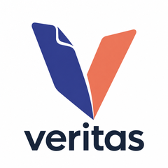
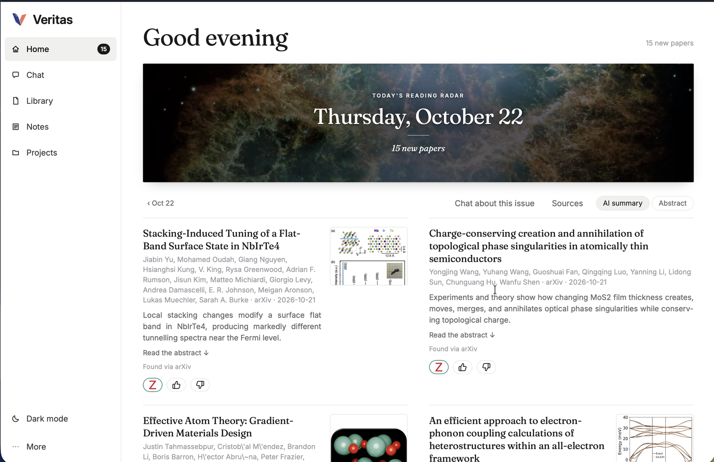
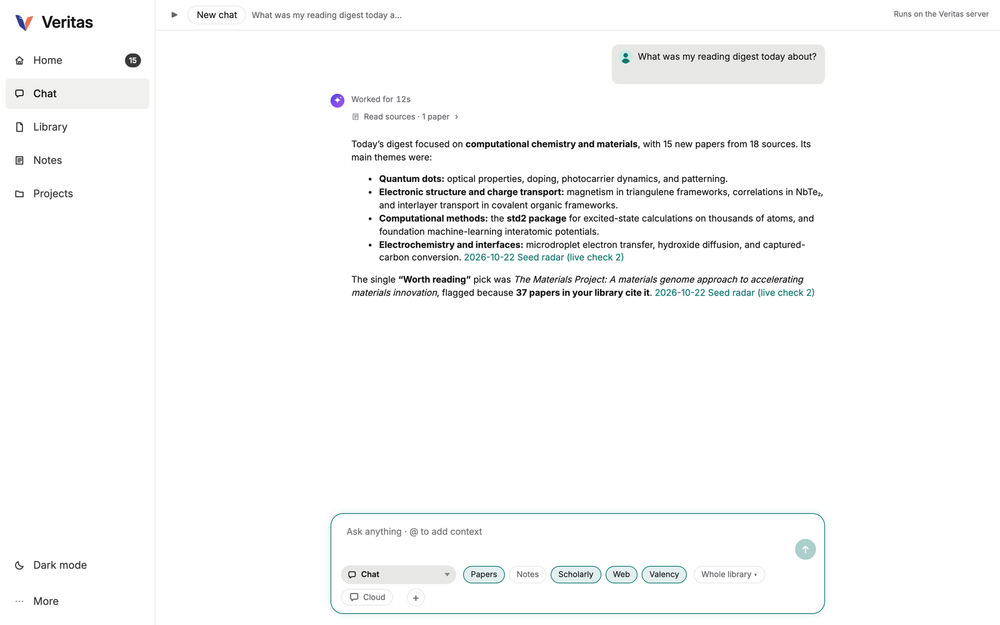

<p align="center"></p>

# Veritas AI

**An open-source research assistant you can check.** Veritas reads your own papers, notes and Zotero library, answers
with citations you can open, and finds new papers for you, on your own machine.

Built during the [OSI Hackathon 2026](https://scientificintelligence.org/campaigns/osi-hackathon-2026) by team
Veritas AI: Joseph Frimpong, Oded Asiedu and Huihuo Zheng.



**Demo video (2 min):** [docs/video/veritas-demo.mp4](https://github.com/frimpsjoek/veritas-ai/blob/main/docs/video/veritas-demo.mp4)

## What it does

- **Chat over your own library and notes**, with every answer cited to a paper or note you can open.
- **A reading radar and daily digest**, seeded by your own papers, that keeps only the new papers close to your work.
- **Links that open**: a DOI goes to your library's PDF or a legal open-access copy.
- **Connectors** for literature tools, including [Valency Bond](https://docs.valency.io/).
- **Research personas**: a [knowledge base](docs/research-personas/research-persona-knowledge-base.md) of 31
  researcher personas across six fields.



## Before and during the hackathon

Before the event we had built the Zotero and Obsidian tools (plugins, search index and chat over your library).
During the hackathon (Oct 21-22, 2026) we built the reading radar and digest with its tools, the link reader, the
Valency connector, the research personas, and Veritas itself: one repository and one knowledge base.

## Repository

| Part | What it is |
|---|---|
| `server/` | Python server: sources, index, search, HTTP API |
| `agent/` | Node agent and its tools |
| `ui/` | Shared UI kit |
| `web/` | Web app (browser and phone) |
| `zotero/` | Zotero plugin |
| `obsidian/` | Obsidian plugin |
| `docs/` | Specs and the research personas |

Run `./check.sh` to build and test everything.

## Install

Needs macOS, Python 3.12 with [uv](https://docs.astral.sh/uv/), and Node 22.

```sh
git clone https://github.com/frimpsjoek/veritas-ai.git && cd veritas-ai

# 1. server and its search model (133 MB, from Hugging Face)
(cd server && uv venv && uv pip install --python .venv/bin/python -r requirements.txt)
M=server/models/snowflake-arctic-embed-s && mkdir -p $M/onnx
for f in onnx/model.onnx tokenizer.json config.json; do
  curl -fL -o $M/$f https://huggingface.co/Snowflake/snowflake-arctic-embed-s/resolve/main/$f
done

# 2. the assistant and the web app
(cd agent && npm ci && npm run build)
(cd web && npm ci && ./install.sh)

# 3. start
cd server && KB_BACKEND=onnx .venv/bin/python kb.py serve
```

Open http://localhost:27182/app/. Veritas finds a Zotero library in `~/Zotero` by itself and writes its notes to
`~/Documents/Veritas`.

**Zotero plugin (optional):** `cd zotero && npm ci && ./build.sh`, then in Zotero: Tools > Plugins > gear >
Install Plugin From File, and pick the `.xpi` in `zotero/dist/`.
**Obsidian plugin (optional):** `cd obsidian && npm ci && npx tsc -p . && node esbuild.config.mjs`, then copy
`main.js`, `manifest.json` and `styles.css` into `<your vault>/.obsidian/plugins/veritas/` and enable it.

## Use

1. **Settings > Folders:** add your Obsidian vault and any folder of notes and PDFs.
2. **Settings > Models:** pick the AI (Claude, Codex or a local model).
3. **Settings > Reading radar:** find your own papers, follow topics, journals and RSS feeds.
4. **Settings > Sources and tools:** connect Valency Bond with the token from
   [app.valency.io/settings](https://app.valency.io/settings).
5. **Home** shows the daily reading radar; **Chat** answers from your library with citations you can open.

## License

MIT. See [LICENSE](LICENSE).
