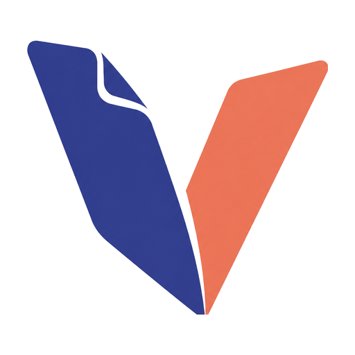
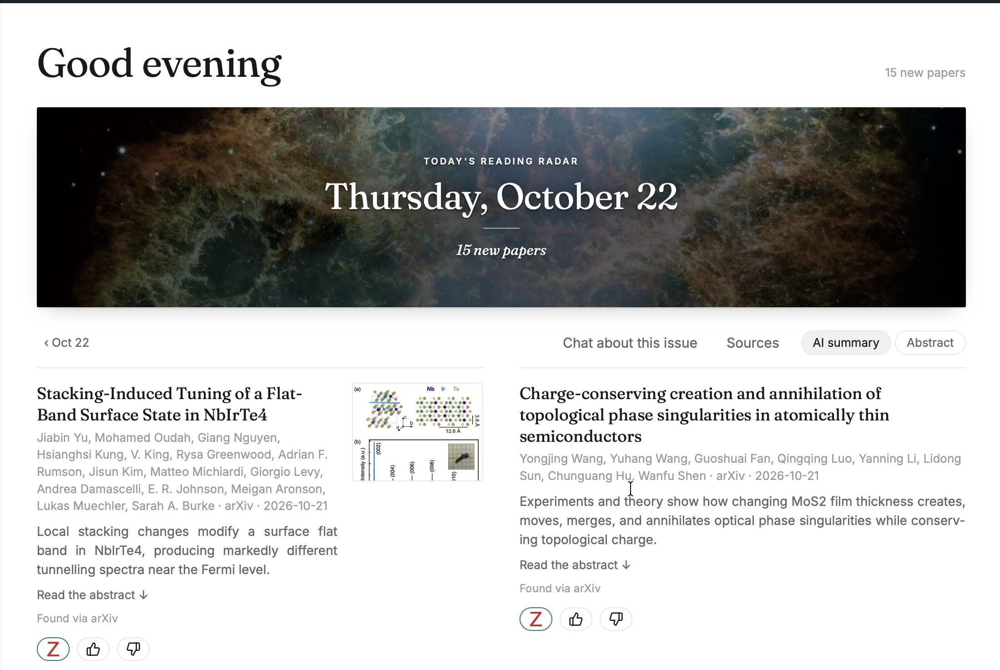
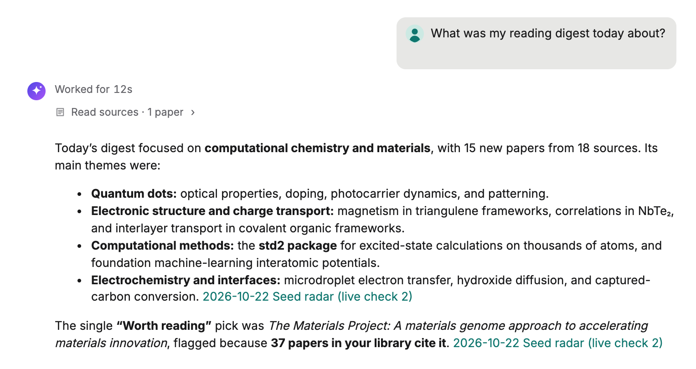
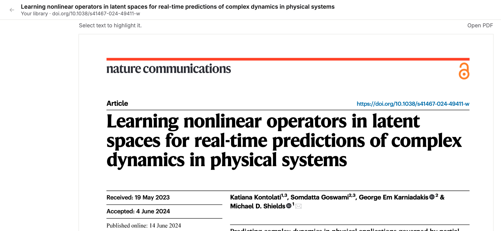

## {.cover .cover-d background-color="#1b2540"}

::: {.cover-motif}

:::

::: {.cover-title}
Veritas AI: an open-source research assistant you can check
:::

::: {.cover-id}
[Joseph Frimpong · Oded Asiedu · Huihuo Zheng]{.cover-name}
[Team Veritas AI]{.cover-aff}
[OSI Hackathon 2026 — October 22, 2026]{.cover-event}
:::

::: {.notes}
Veritas reads your own papers, notes and Zotero library, answers with citations you can open, and brings you a daily reading radar.
:::

## Team Veritas AI

::: {.lead}
We built Veritas at the **OSI Hackathon 2026**.
:::

::: {.team-row}
::: {.person}
{.headshot}

[Joseph Frimpong]{.pname}

[Argonne National Laboratory]{.paff}
:::
::: {.person}
{.headshot}

[Oded Asiedu]{.pname}
:::
::: {.person}
{.headshot}

[Huihuo Zheng]{.pname}

[Argonne National Laboratory]{.paff}
:::
:::

::: {.notes}
We built Veritas at the OSI Hackathon 2026.
:::

## Three places, no link

::: {.lead}
A scientist's knowledge sits in **three places that do not talk to each other**:
:::

::: {.places}
::: {.place}
{.biglogo}

**Reference manager**
:::
::: {.place}
{.biglogo}

**Notes**
:::
::: {.place}
{.biglogo}

**New preprints**
:::
:::

::: {.iconlist}
- {.ic} Chat assistants answer from none of them, and cite papers you cannot open
- {.ic} Veritas joins the three on **your own device** and links every answer to a paper or note you can check
:::

::: {.notes}
The problem in one sentence; then what Veritas does about it.
:::

## Reading radar

:::: {.columns}
::: {.column width="62%"}

:::
::: {.column width="38%"}
::: {.iconlist}
- {.ic} Starts from **the papers you wrote** and your interests
- {.ic} Watches arXiv, journals, **RSS feeds** and Valency Bond
- {.ic} Keeps only new papers close to your work, and says which of your papers each one matches
- {.ic} Like or dislike a paper: it **learns your taste**
:::

::: {.logorow}
{.ic .logo} {.ic .logo} {.ic .logo} {.ic .logo} {.ic .logo} {.ic .logo} {.ic .logo}
:::
:::
::::

::: {.notes}
On Oct 22 the radar kept 15 new papers from 18 sources.
:::

## Chat with citations

:::: {.columns}
::: {.column width="62%"}

:::
::: {.column width="38%"}
::: {.iconlist}
- {.ic} Ask about your library, your notes or **today's digest**
- {.ic} Every claim cites a paper or note
- {.ic} Sources on or off per question: Papers, Notes, Scholarly, Web, **Valency**
:::
:::
::::

::: {.notes}
"What was my reading digest today about?" is answered from the digest itself, with citations to it.
:::

## Links that open

:::: {.columns}
::: {.column width="62%"}

:::
::: {.column width="38%"}
::: {.iconlist}
- {.ic} A DOI opens **the PDF in your library**
- {.ic} Else a **legal open-access copy** (OpenAlex), else the abstract
- {.ic} Publishers that block bots and frames no longer break the link
:::
:::
::::

::: {.notes}
A paywalled ACS DOI opened its open-access arXiv preprint inside Veritas.
:::

## Connects to

:::: {.columns .plain3}
::: {.column width="32%"}
**Your sources**

::: {.iconlist}
- {.ic .logo} Zotero library
- {.ic .logo} Obsidian notes
- {.ic} Any folder of notes and PDFs
:::
:::
::: {.column width="32%"}
**The literature**

::: {.iconlist}
- {.ic .logo} arXiv
- {.ic .logo} OpenAlex and journals
- {.ic .logo} RSS feeds you follow
- {.ic .logo} Valency Bond: 500M+ papers, ChemRxiv included
:::
:::
::: {.column width="32%"}
**Your AI**

::: {.iconlist}
- {.ic} Runs on your own device
- {.ic .logo} Through MCP, your library plugs into any AI chat that supports it
- {.ic .logo} Claude
- {.ic .logo} ChatGPT and others
:::
:::
::::

::: {.notes}
Sources, literature, and how it reaches your AI.
:::

## Veritas AI {.textslide}

::: {.lead}
Before the event we had built the Zotero and Obsidian tools. **During the hackathon** we built:
:::

::: {.iconlist}
- {.ic} the reading radar and daily digest, with tools the assistant uses to read it
- {.ic} links that open papers directly, and the Valency Bond connector
- {.ic} a knowledge base of 31 research personas, and Veritas itself as one open-source project
- {.ic} **Next:** persona agents: pick fields such as HPC and computational chemistry, and Veritas answers from each angle
:::

{.ic} **Open source (MIT):** [github.com/frimpsjoek/veritas-ai](https://github.com/frimpsjoek/veritas-ai)

::: {.notes}
Close with the repository link.
:::
